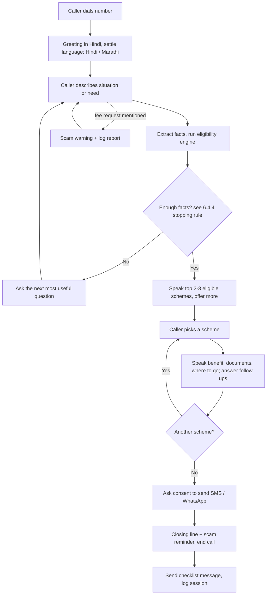
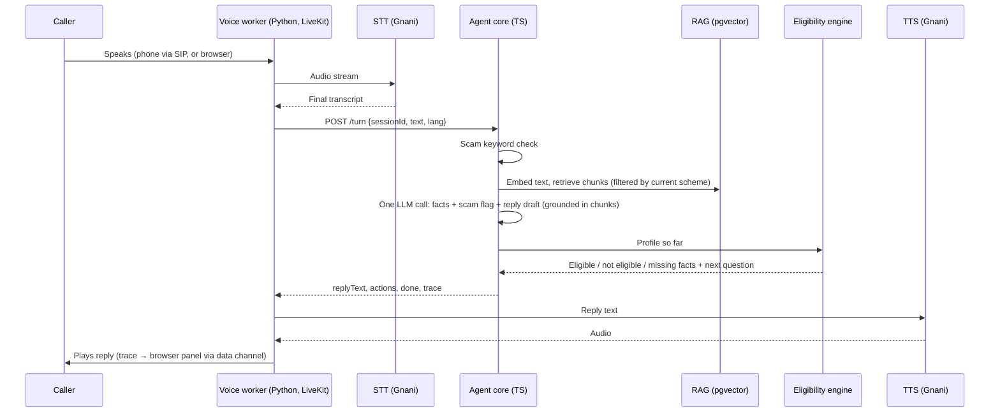
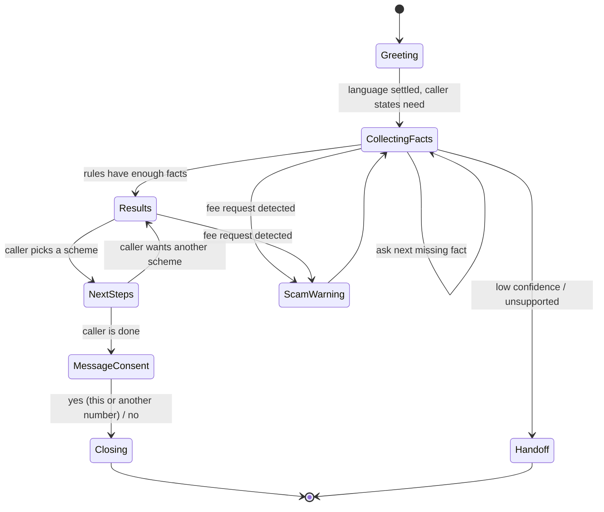
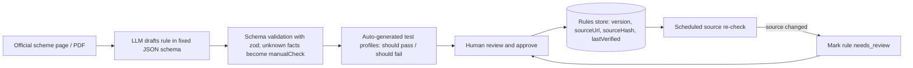

# Yojana Darshak

**A free, voice-first phone line that helps rural citizens find out which government schemes they qualify for, in their own language, on any phone.**

---

## 1. Problem

Government schemes, crop advice and health information are published mostly in English or formal Hindi, on websites and PDFs. Rural citizens — farmers, rural families, ASHA workers' beneficiaries — often:

- speak a regional language or dialect, and mix languages (Hinglish, Marathi-Hindi),
- have low literacy or are uncomfortable with apps and forms,
- use basic feature phones or have patchy mobile data,
- don't know which schemes apply to *them*, what documents to bring, or where to go,
- are targeted by fake agents who charge money to "register" them for free schemes.

## 2. Target users

| User | What they need |
|---|---|
| Farmers and rural families | "Which schemes can I get, what do I carry, where do I go?" |
| ASHA workers, CSC operators, panchayat staff | A tool to help many villagers quickly, and visibility into what people need |
| (Future) District / scheme administrators | Demand signals: which schemes people ask about, where awareness is low |

## 3. Why this is not "just another chatbot"

A general assistant (ChatGPT, Claude voice mode) can *talk about* schemes. Yojana darshak is different in five structural ways:

1. **Reaches people who will never open a chatbot app.** Works through a normal phone call on any phone — no app, no account, no internet, no reading. WhatsApp voice notes for smartphone users. Browser calling for demos.
2. **Eligibility is computed, not guessed.** The LLM only runs the conversation and extracts facts. A deterministic **rules engine** decides eligibility from verified scheme rules. Every answer can cite its official source. If unsure, it says so and points to the CSC.
3. **Ends in an action, not just an answer.** The caller receives an SMS/WhatsApp checklist of documents, the nearest Common Service Centre (CSC) or office, and what to say there.
4. **Proactive, not only reactive (stretch).** Remembers the caller's profile (crop, land, district) and can call back about new schemes, deadlines or crop alerts.
5. **Scam protection.** Detects "someone is asking me for money to register" and warns that the scheme is free, with official channels.

Plus an **intermediary dashboard** for ASHA workers / CSC operators, turning the product from a chatbot into a tool a local institution can adopt.

**Pitch line:** *"A chatbot answers questions. We built a free phone line that works on any phone, decides eligibility with verified rules instead of guesses, tells you exactly what to carry and where to go, and warns you about scams."*

---

## 4. How the product works (user workflow)

### 4.1 Caller journey

1. **Call** — The farmer dials the Yojana darshak number (or sends a WhatsApp voice note).
2. **Greet + language** — The assistant greets in Hindi and settles the caller's language: Hindi or Marathi for the prototype (code-mixed speech is fine). See 6.10 for how the language is detected.
3. **Understand the need** — Caller speaks freely: *"Mere paas 3 bigha zameen hai, gehu ugata hoon, koi yojana hai kya?"*
4. **Ask only what's missing** — The assistant asks short follow-up questions, one at a time, only for facts the eligibility rules still need (state, land size, category, age, income tax payer or not, etc.).
5. **Eligibility result** — It speaks back the schemes the caller qualifies for, why, and the benefit in simple words.
6. **Next steps** — For each chosen scheme: required documents, nearest CSC/office, and what to say there.
7. **Scam check (anytime)** — If the caller mentions being asked for money, the assistant warns them and logs the report.
8. **Follow-up message** — After the call, an SMS/WhatsApp message with the document checklist and office details.
9. **(Stretch) Proactive callback** — Later alerts about deadlines or newly eligible schemes.

### 4.2 Intermediary journey (ASHA / CSC dashboard)

1. Sees a list of recent callers from their area (with consent), their eligible schemes and pending next steps.
2. Sees village-level demand: most-asked schemes, common unmet needs, scam reports.
3. Can trigger a follow-up message to a caller.

### 4.3 Call flow: what is spoken vs what is sent

The agent answers **on the same call, by voice**, like a normal phone conversation. The caller hangs up already knowing the answer. The SMS/WhatsApp message afterwards is a **written copy of the things that are hard to remember from audio**.

| Spoken on the call | Sent as SMS/WhatsApp after the call |
|---|---|
| Follow-up questions | Document checklist for each chosen scheme |
| Which schemes they qualify for, and why, in simple words | Nearest CSC / office name and address |
| The benefit ("saal mein 6,000 rupaye, teen kishton mein") | Official links and helpline number |
| Answers to follow-ups ("paisa kab aayega?") | Scam reminder: the scheme is free |
| A short version of what to carry and where to go | |
| Scam warning, when needed | |

Why both: lists of documents and addresses are forgotten a minute after hanging up. The message can also be shown to a CSC operator or to a family member who can read.

**Rules for the spoken part**
- **Never read a long list.** Speak at most 2–3 schemes at a time, then offer more: *"Aur bhi 3 yojanayein hain, sunna chahenge?"*
- **Let the caller pick one scheme** and go deeper on just that one: *"Kis yojana ke baare mein detail chahiye?"*
- **One question per turn**, short sentences, no acronyms where avoidable.
- **No read-back of facts** in the prototype (keeps calls short); the caller can correct any fact at any time.
- **Ask before sending the message**, and offer a different number, since many families share one phone: *"Kya main yeh jaankari isi number par SMS kar doon?"*
- **Close clearly:** *"Aapko SMS mil jayega. Yaad rakhiye, yeh yojana bilkul free hai, koi paise maange toh mat dijiye."*

**End-to-end call flow**



**Sample call**

> **Agent:** Namaste! Main Yojana darshak hoon. Aap kis cheez mein madad chahte hain?
> **Farmer:** Mere paas zameen hai, koi sarkari yojana milegi kya?
> **Agent:** Aapke paas kitni zameen hai?
> **Farmer:** Teen acre.
> **Agent:** Aap kis rajya mein rehte hain?
> **Farmer:** Maharashtra.
> **Agent:** Kya aap income tax bharte hain?
> **Farmer:** Nahi.
> **Agent:** Aap do yojanaon ke liye eligible hain: PM-Kisan, jisme saal mein 6,000 rupaye milte hain, aur Maharashtra ki Namo Shetkari yojana, jisme 6,000 rupaye aur milte hain. Kiske baare mein detail chahiye?
> **Farmer:** PM-Kisan.
> **Agent:** Iske liye Aadhaar, zameen ke kagaz aur bank passbook lekar apne nazdeeki CSC jaiye. Kya main yeh list aapko SMS kar doon?
> **Farmer:** Haan.
> **Agent:** Theek hai, SMS bhej diya jayega. Yaad rakhiye, yeh yojana bilkul free hai. Koi paise maange toh mat dijiye. Dhanyavaad!

*(Scheme details in the sample are illustrative; final wording comes from verified scheme data.)*

---

## 5. System architecture

The system is split into three layers. The **agent core is built once** and reused by every channel; only the voice/channel layer changes as the build matures.

```
┌─────────────────────────────── Channels ───────────────────────────────┐
│  Phone call (PSTN)      WhatsApp voice note      Browser call (WebRTC)  │
└───────────────┬─────────────────────┬───────────────────────┬──────────┘
                ▼                     ▼                       ▼
┌──────────────────────────── Voice / channel layer ─────────────────────┐
│  LiveKit Cloud (WebRTC rooms) ← Twilio number via SIP trunk             │
│  Voice worker (Python, LiveKit Agents): VAD, barge-in, turn detection   │
│  Speech-to-text + Text-to-speech (Gnani plugin; alt: Sarvam, Bhashini)  │
└─────────────────────────────────┬───────────────────────────────────────┘
                                  ▼   HTTP: POST /turn {sessionId, text, lang}
┌────────────────────────── Agent core (Node + TypeScript) ──────────────┐
│  Session manager · LLM fact extractor · Eligibility engine (rules)      │
│  Scheme knowledge base (RAG, for explanations) · Scam check             │
│  Response composer · Action dispatcher                                  │
└─────────────────────────────────┬───────────────────────────────────────┘
                                  ▼
┌──────────────────────────── Data + actions ────────────────────────────┐
│  Database (profiles, sessions, call logs, scam reports)                 │
│  SMS / WhatsApp checklist · CSC/office lookup · Dashboard (Next.js)     │
└─────────────────────────────────────────────────────────────────────────┘
```

### 5.1 Single-turn workflow (what happens each time the caller speaks)



### 5.2 Conversation state machine



---

## 6. Core components

### 6.1 Agent core interface

Every channel calls one function, which makes the core testable over plain text before any phone integration. The core is a Node + TypeScript service; the Python voice worker reaches it over HTTP (`POST /turn`), the text chat and test scripts call it the same way.

```ts
handleTurn(sessionId: string, userText: string, lang: "hi" | "mr"): Promise<{
  replyText: string;        // what to say next, in the caller's language, Devanagari script
  actions: Action[];        // e.g. SEND_CHECKLIST, LOG_SCAM_REPORT, HANDOFF, SET_LANGUAGE
  done: boolean;            // conversation finished
  trace: Trace;             // facts so far, per-scheme status, chosen next question (for the live panel)
}>
```

**HTTP API** (`core/src/server.ts`, Express 5; `npm start` / `npm run dev` in `core/`):

| Endpoint | Body | Returns |
|---|---|---|
| `GET /health` | – | `{ ok: true }` (no auth) |
| `POST /turn` | `{ sessionId, text, lang?, callerNumber?, channel? }` | `{ replyText, actions, done, trace }` |
| `POST /sessions/:id/language` | `{ lang }` | Turn result with `SET_LANGUAGE` and the pending question repeated in the new language; 404 for an unknown session |
| `POST /sessions/:id/end` | – | `{ ended }`; called by a channel on hang-up (Supabase persistence hooks in here later) |

- If `CORE_API_KEY` is set, `/turn` and `/sessions` require `Authorization: Bearer <key>` (the voice worker holds it). `CORS_ORIGIN` optionally allows one browser origin.
- Body limit 16 KB, text up to 2,000 characters. An LLM failure still returns 200 with a "sorry, please repeat" reply, so a live call never goes silent.

The first call for a new `sessionId` (any text, usually empty) returns the greeting. An optional fourth argument carries channel metadata (`callerNumber`, `channel`), used as the default checklist recipient. Implementation: `core/src/agent/turn.ts`; try it over text with `npm run chat` in `core/` (`-- mr` for Marathi, `-- en` for an English **test mode**: same flow and data, English templates, never auto-switches; callers only ever get hi/mr). Every localized string in `data/` therefore carries `hi`, `mr` and `en`.

### 6.2 Session manager
- Session keyed by call ID / WhatsApp number.
- Holds: detected language, extracted profile facts, conversation history, current state.
- In-memory Map for the prototype; Redis for anything persistent across restarts.

### 6.3 LLM fact extractor
- **One LLM call per turn** (`gpt-4.1-mini`, strict structured output; the prototype has a tight LLM budget). The response contains: extracted facts, the language actually spoken, an explicit language-switch request, topics, intent (give_info / ask_question / pick_scheme / want_more / yes / no / done), the picked scheme, an alternate phone number, a scam flag, and — only for follow-up questions — a short answer grounded in the retrieved chunks.
- The LLM sees which question is pending, so a bare "haan / nahi" fills the right fact.
- **The LLM does not write the rest of the reply.** The engine's next question comes from the `ask` prompts in `data/facts.json`, and results/details are composed from templates plus verified scheme data (6.7). Reason: with one call per turn, the next question can only be chosen *after* this turn's facts are extracted, and amounts/documents should never be paraphrased.
- Converts free speech into structured facts using structured output (JSON schema), e.g.
  `"3 bigha zameen, gehu"` → `{ "landArea": { "value": 3, "unit": "bigha" }, "crop": "wheat" }`, which the core converts to `landHectares` using the caller's state.
- Normalises local units (bigha, acre, hectare) and code-mixed terms.
- Replies are written in Devanagari script (TTS pronounces it far better than romanised Hinglish).
- Phrases the **next question chosen by the eligibility engine** (see 6.4.4) naturally, in the caller's language.
- Never decides eligibility itself.

### 6.4 Eligibility engine (deterministic)

**Principle:** the LLM never decides eligibility. Code evaluates verified rules. The LLM is used only (a) at call time to extract facts from speech and (b) offline to *draft* rules that a human then reviews.

**Storage is not the problem.** myScheme lists 4,000+ central and state schemes; at 1–3 KB of JSON per scheme, all of them fit in a few MB. The hard part is turning prose eligibility text into correct rules and keeping them current. The design below addresses that.

#### 6.4.1 Two tiers of confidence

| Tier | Coverage | How it decides | What the caller hears |
|---|---|---|---|
| **Tier 1: verified rules** | Small, high-impact set (10–15 for the prototype; a few hundred in production) | Full rule tree, hand-verified, deterministic | *"Aap is yojana ke liye eligible hain."* |
| **Tier 2: screening** | Long tail (thousands of schemes) | Coarse attributes only: state, age, gender, income, occupation, social category, disability, rural/urban (the same kind of attributes myScheme's finder uses) | *"Aap shayad is yojana ke liye eligible ho sakte hain. CSC par confirm karein."* + explanation from official text |

Precise where it matters, honest where it isn't sure.

#### 6.4.2 Fact vocabulary

All rules may only reference facts from a fixed, versioned vocabulary. This keeps rules comparable and lets the engine know which question resolves the most schemes.

Each fact has an `askable` flag. Sensitive facts (pregnancy, caste/social category) are `askable: false`: the engine never asks for them and uses them only when the caller volunteers them.

The prototype scheme set uses 27 facts (see `data/facts.json`):
- **Askable (19):** state, ownsCultivableLand, isTenantFarmer, age, familyPaysIncomeTax, isIncomeTaxPayer, familyHasGovtEmployeeOrPensioner, isGovtEmployee, hasOtherPensionScheme, landHectares, hasWaterSource, hasConventionalPump, crop, gender, hasBankAccount, residence, hasPuccaHouse, hasLpgConnection, annualFamilyIncome.
- **Not askable (used only if volunteered):** isPregnantOrLactating, isFrontlineWorker, isDisabled, socialCategory, familyHasRegisteredProfessional, familyHasPublicOffice, landAcquiredAfterCutoff, hadSolarPumpSubsidy.

Family-level and personal versions of the same exclusion are separate facts (PM-KISAN excludes by family, PM Kisan Maandhan and Atal Pension by the person), linked by `derives`.

```ts
const FACTS = {
  state:              { type: "enum",    ask: { hi: "Aap kis rajya mein rehte hain?" } },
  age:                { type: "number",  ask: { hi: "Aapki umar kitni hai?" } },
  gender:             { type: "enum",    ask: { hi: "..." } },
  ownsCultivableLand: { type: "boolean", ask: { hi: "Kya aapke naam par kheti ki zameen hai?" } },
  landHectares:       { type: "number",  ask: { hi: "Aapke paas kitni zameen hai?" } }, // bigha/acre normalised
  crop:               { type: "string",  ask: { hi: "Aap kaun si fasal ugate hain?" } },
  isIncomeTaxPayer:   { type: "boolean", ask: { hi: "Kya aap income tax bharte hain?" } },
  isGovtEmployee:     { type: "boolean", ask: { hi: "..." } },
  socialCategory:     { type: "enum",    ask: { hi: "..." } },
  annualIncome:       { type: "number",  ask: { hi: "..." } },
  residence:          { type: "enum",    ask: { hi: "Aap gaon mein rehte hain ya shehar mein?" } },
  // ...
} as const;
```

Land units (bigha, acre, guntha, hectare) are normalised by the fact extractor; bigha varies by state, so conversion uses the caller's state. Maharashtra farmers use acre and guntha (1 acre = 40 guntha), not bigha. `landHectares` is the single canonical land fact everywhere (rules, profile, database). Every `ask` prompt has `hi` and `mr` variants.

**Derived facts (`derives`).** A fact can set related facts when it takes a value, so the engine never asks a question whose answer is already implied. Example: `familyPaysIncomeTax = false` sets `isIncomeTaxPayer = false`; `isIncomeTaxPayer = true` sets `familyPaysIncomeTax = true`. Derivations run after every extraction, before evaluation. A value the caller states directly always wins over a derived one.

The vocabulary lives in `data/facts.json`; scheme rules live in `data/schemes/<id>.json`.

#### 6.4.3 Rule format and three-valued evaluation

During a conversation many facts are still unknown, so every condition evaluates to `true`, `false` or `unknown`:

- any required condition `false` → **not eligible**
- all conditions `true` → **eligible**
- otherwise → **need more info**, plus the list of missing facts

Conditions that cannot be expressed with the vocabulary (e.g. "small farmer as per state definition") are encoded as `manualCheck`. A scheme with a `manualCheck` can at best be **"likely eligible, verify at CSC"**, never a definite yes.

**Rare exclusions (`assumeIfUnknown` + `caveat`).** Some exclusions apply to very few rural callers (a minister or MLA in the family, a practising doctor or lawyer, land bought after PM-KISAN's 01.02.2019 cut-off). Asking each one would make calls far too long. These conditions reference `askable: false` facts and carry `assumeIfUnknown: true` with a `caveat` in Hindi and Marathi:
- If the caller volunteered the fact, it is evaluated normally (and can make the scheme `not_eligible`).
- If unknown, the condition counts as `true`, it is **not** added to the missing facts, and its caveat is attached to the result.
- Caveats go into the WhatsApp/SMS message in full; on the call, at most one short line ("*agar parivar mein koi MLA ya mantri nahi hai*").
- Only `askable: false` facts may use `assumeIfUnknown`; everything else must be asked or be a `manualCheck`.

Illustrative rule (exact criteria must be verified against official guidelines, e.g. myScheme.gov.in and the scheme's own portal):

```json
{
  "id": "pm-kisan",
  "name": { "en": "PM-KISAN", "hi": "पीएम किसान सम्मान निधि" },
  "level": "central",
  "tier": 1,
  "rules": {
    "all": [
      { "fact": "ownsCultivableLand", "op": "eq", "value": true },
      { "fact": "isIncomeTaxPayer",   "op": "eq", "value": false },
      { "fact": "isGovtEmployee",     "op": "eq", "value": false }
    ]
  },
  "benefitSummary": { "hi": "...", "en": "..." },
  "documents": ["Aadhaar", "Land records", "Bank account details"],
  "applyAt": ["CSC", "pmkisan.gov.in"],
  "source": "https://pmkisan.gov.in/",
  "sourceHash": "sha256:...",
  "version": 3,
  "lastVerified": "2026-10-30",
  "status": "approved"
}
```

Evaluator (custom, ~30 lines; libraries such as `json-rules-engine` or `json-logic-js` are alternatives, but the custom version makes "unknown" handling and next-question selection simpler):

```ts
type Tri = true | false | "unknown";
type Cond =
  | { all: Cond[] } | { any: Cond[] } | { not: Cond }
  | { manualCheck: string }
  | { fact: string; op: "eq" | "lte" | "gte" | "in"; value: unknown;
      assumeIfUnknown?: boolean; caveat?: { hi: string; mr: string } };

type Ctx = { missing: Set<string>; caveats: Cond[] };

function evaluate(c: Cond, facts: Record<string, unknown>, ctx: Ctx): Tri {
  if ("all" in c) {
    const r = c.all.map(x => evaluate(x, facts, ctx));
    if (r.includes(false)) return false;
    return r.includes("unknown") ? "unknown" : true;
  }
  if ("any" in c) {
    const r = c.any.map(x => evaluate(x, facts, ctx));
    if (r.includes(true)) return true;
    return r.includes("unknown") ? "unknown" : false;
  }
  if ("not" in c) {
    const r = evaluate(c.not, facts, ctx);
    return r === "unknown" ? r : !r;
  }
  if ("manualCheck" in c) return "unknown"; // can never be confirmed automatically
  const v = facts[c.fact];
  if (v === undefined) {
    if (c.assumeIfUnknown) { ctx.caveats.push(c); return true; } // rare exclusion: assume, attach caveat
    ctx.missing.add(c.fact);
    return "unknown";
  }
  switch (c.op) {
    case "eq":  return v === c.value;
    case "lte": return (v as number) <= (c.value as number);
    case "gte": return (v as number) >= (c.value as number);
    case "in":  return (c.value as unknown[]).includes(v);
  }
}
```

Missing facts and caveats only propagate from branches that matter: a satisfied `any` drops the missing facts of its other branches, and a failed `all` drops everything.

**Status when only non-askable facts are unknown.** If a scheme is still `unknown` but none of its missing facts can be asked, the engine re-evaluates it treating unvolunteered non-askable facts as `false`. Still `unknown` → only `manualCheck`s remain → `likely_eligible` (e.g. PM-JAY for a 45-year-old: "on the PM-JAY list" is checked at the CSC). `false` → `not_eligible` (e.g. maternity benefit when no pregnancy was mentioned; it reopens as soon as the caller mentions it).

Implementation: `core/src/engine/` (tests in `core/test/engine.test.ts` run against the real `data/` files).

Per scheme the engine returns: `status` (`eligible | likely_eligible | not_eligible | need_more_info`), the reasons (which conditions passed or failed), the missing facts, and any caveats. `likely_eligible` = all automatable conditions pass but a `manualCheck` remains, or a Tier 2 screening match.

#### 6.4.4 Choosing the next question

Among all schemes still `need_more_info`, count how often each missing fact appears and ask the most frequent one first (tie-break: a fixed priority order in the fact vocabulary, easier questions first — e.g. state, then land ownership, then age, then income). Example: "Do you own farmland?" may resolve six schemes at once; "Are you a widow?" resolves one. This keeps phone calls short. The LLM only phrases the chosen question naturally.

```ts
function nextQuestion(results: SchemeResult[]): string | null {
  const counts = new Map<string, number>();
  for (const r of results.filter(r => r.status === "need_more_info"))
    for (const f of r.missingFacts) counts.set(f, (counts.get(f) ?? 0) + 1);
  return [...counts.entries()]
    .sort((a, b) => b[1] - a[1] || FACT_PRIORITY.indexOf(a[0]) - FACT_PRIORITY.indexOf(b[0]))[0]?.[0] ?? null;
}
```

**Stopping rule ("enough facts")**
1. Every scheme carries `topics` (farming, health, housing, women, insurance, pension, household). The caller's first utterance selects the topics evaluated first; a farmer talking about land gets farming schemes first. Other topics are considered only after that.
2. Only `askable` facts are asked, and only for schemes in the active topics.
3. After at most 4–5 questions (or as soon as no active-topic scheme is `need_more_info`), the assistant speaks what is already eligible / likely eligible and offers: *"Kuch aur yojanayein bhi ho sakti hain, check karein?"* A yes widens the topics and resumes questioning.

#### 6.4.5 Rule authoring pipeline (LLM offline, human approves)



- The LLM can only use facts from the vocabulary; anything else becomes `manualCheck`.
- Only `approved` rules are used at call time. A rule whose source page changed drops to `needs_review` and is treated as Tier 2 until re-approved.
- Every answer can cite `source` and `lastVerified`.

**Demo moment:** paste a new scheme's PDF, show the generated rule and its tests, approve it, then call and get an answer about that scheme — coverage scales without ever trusting the LLM with the decision.

#### 6.4.6 Data sources

- Official scheme portals and guidelines (source of truth for Tier 1).
- myScheme.gov.in for discovering schemes and their published eligibility text. No public API was found; community-scraped datasets exist, but check licensing and myScheme's terms before relying on them.
- Prototype scheme set (approved): 21 Tier 1 schemes, hand-curated, every rule to be verified against the official portal before `status: approved`. Rules take the state into account. Whether more are added live via the authoring pipeline is to be decided.

| # | Scheme | Level | Topic | Key facts | Best possible result |
|---|---|---|---|---|---|
| 1 | PM-KISAN | Central | farming | ownsCultivableLand, familyPaysIncomeTax, familyHasGovtEmployeeOrPensioner; rare exclusions via assumeIfUnknown | eligible (with caveats) |
| 2 | Namo Shetkari Mahasanman Nidhi | Maharashtra | farming | state = MH + PM-KISAN conditions | eligible (with caveats) |
| 3 | PM Fasal Bima Yojana | Central | farming, insurance | ownsCultivableLand or isTenantFarmer; notified crop/area = manualCheck | likely_eligible |
| 4 | Kisan Credit Card | Central | farming | ownsCultivableLand or isTenantFarmer (age limits are bank policy, not encoded) | eligible |
| 5 | PM Kisan Maandhan | Central | farming, pension | ownsCultivableLand, landHectares ≤ 2, age 18–40, hasOtherPensionScheme, isIncomeTaxPayer, isGovtEmployee | eligible (with caveats) |
| 6 | Magel Tyala Saur Krushi Pump | Maharashtra | farming | state = MH, ownsCultivableLand, hasWaterSource, hasConventionalPump; water source verified by MSEDCL = manualCheck | likely_eligible |
| 7 | PM Ujjwala Yojana | Central | women, household | gender, age ≥ 18, hasLpgConnection; eligible category / deprivation declaration = manualCheck | likely_eligible |
| 8 | PM Awas Yojana – Gramin | Central | housing | residence = rural, hasPuccaHouse, familyPaysIncomeTax; Awaas+ list + other exclusions = manualCheck | likely_eligible |
| 9 | Ayushman Bharat PM-JAY | Central | health | any: age ≥ 70, isFrontlineWorker, or on PM-JAY list (manualCheck) | eligible (70+, ASHA/AWW) / likely_eligible |
| 10 | PM Matru Vandana Yojana | Central | women, health | gender, isPregnantOrLactating (not askable), isGovtEmployee, any of SC/ST / income ≤ ₹8 lakh / disability / ASHA-AWW; child order = manualCheck | likely_eligible |
| 11 | PM Jeevan Jyoti Bima | Central | insurance | age 18–50, hasBankAccount | eligible |
| 12 | PM Suraksha Bima | Central | insurance | age 18–70, hasBankAccount | eligible |
| 13 | Atal Pension Yojana | Central | pension | age 18–40, hasBankAccount, isIncomeTaxPayer | eligible |
| 14 | VB-G RAM G rural job guarantee (replaced MGNREGA on 1 Jul 2026, 125 days) | Central | work | residence = rural, age ≥ 18, willingManualWork | eligible |
| 15 | e-Shram card | Central | work, insurance | age 16–59, hasPfOrEsic, isIncomeTaxPayer, isGovtEmployee | eligible |
| 16 | Sanjay Gandhi Niradhar Anudan | Maharashtra | welfare, women, pension | state = MH, age ≤ 64, any: (female widow/single woman, income ≤ ₹21,000) / (isDisabled, income ≤ ₹50,000) | eligible |
| 17 | Shravanbal Seva old-age pension | Maharashtra | pension, welfare | state = MH, age ≥ 65, income ≤ ₹21,000 | eligible |
| 18 | NMMS scholarship | Central | education | studentLevel = class8, studentInGovtSchool, income ≤ ₹3.5 lakh; Class 7 marks + selection exam = manualCheck | likely_eligible |
| 19 | Central Sector Scholarship (PM-USP) | Central | education | studentLevel degree/postgrad, income ≤ ₹4.5 lakh; 80th percentile in Class 12 = manualCheck | likely_eligible |
| 20 | Post-Matric Scholarship for SC | Central (via MahaDBT) | education | socialCategory = SC, studentLevel ≥ class 11, income ≤ ₹2.5 lakh | eligible |
| 21 | Rajarshi Shahu Maharaj fee reimbursement | Maharashtra | education | state = MH, socialCategory = GEN, studentLevel diploma/degree/postgrad, income ≤ ₹8 lakh; CAP admission = manualCheck | likely_eligible |

**Topic-gated facts.** A fact can carry `topics`; it is only asked when the caller's topics include one of them. Caste (`socialCategory`) and the student facts are asked only on the education topic, `willingManualWork` / `hasPfOrEsic` only on work, `isWidowOrSingleWoman` only on welfare/women/pension. A caller with no topic is never asked these.

**Student = beneficiary, caller may be a parent.** Student facts (`studentLevel`, `studentInGovtSchool`) describe the student; scholarship rules use only those plus family-level facts (income, state, category), never the caller's own age or gender, so a parent asking for a child gets the right answer.

Rule files: `data/schemes/<id>.json` (all `status: draft` until reviewed). Items marked `TO_VERIFY` in a file (some helplines, FY 2026-27 LPG subsidy, solar pump documents) must be resolved or dropped before approval.

**RAG only (no Tier 1 rule):**
- Majhi Ladki Bahin (Maharashtra): reportedly closed to new applications; the corpus notes that, so the assistant never sends callers to apply.
- Mahatma Phule Jan Arogya Yojana (Maharashtra): eligibility (ration card type, cover, PM-JAY integration) unclear across sources; answered only as "likely eligible, confirm at CSC".
- Corpus also notes that Maharashtra's ₹1 crop insurance scheme was discontinued in 2025 (standard PMFBY premiums apply).

### 6.5 Scheme knowledge base (RAG)
RAG is a required part of the product. It explains; it never decides eligibility.

**Corpus (`data/corpus/`, built in code by `core/src/rag/corpus.ts`)**
- `docs/*.txt` + `documents.json`: text of 15 official PDFs (operational guidelines, rules, PIB factsheets) for the rule schemes, split into ~1,200-character windows on sentence boundaries with ~200 characters of overlap.
- Summary chunks in hi / mr / en for each of the 21 rule schemes, generated from the verified scheme files, because most source documents are English and Hindi/Marathi questions match same-language text better.
- `extra-schemes.json`: 20 RAG-only schemes (Ladki Bahin, MJPJAY, PM-SYM, PM Vishwakarma, free ration, PM Vidyalaxmi, PM SVANidhi, Mudra, Stand-Up India, PMEGP, Sukanya Samriddhi, PM Surya Ghar, SBM-G toilet, Soil Health Card, Lek Ladki, construction workers board, NFBS, JSY, Gopinath Munde accident grant, UDID), each with English text plus hi/mr summaries. Tagged `tier: extra`.
- About 1,000 chunks (~250k tokens). Metadata per chunk: `id`, `schemeId`, `tier`, `title`, `section`, `lang`, `sourceUrl`, content hash.

**Ingestion (`npm run rag:ingest`)**
- Creates the `rag_chunks` table (pgvector, HNSW cosine index, RLS on with no policies so the public Supabase API can't read it) and embeds only new or changed chunks with `text-embedding-3-small`; removed chunks are deleted.

**At call time (inside the same single LLM call per turn)**
1. Skip retrieval for plain answers to the engine's own question ("हाँ", "तीस साल": short and no question word); retrieve otherwise.
2. Embed the utterance; search pgvector for up to 3 chunks of the schemes in focus plus the best overall, 4 in total.
3. The chunks go into the LLM call as numbered passages marked `rules="verified"` or `rules="none"` (RAG-only scheme → only "may be eligible, confirm at CSC").
4. The answer may only use those passages, and the LLM returns which ones it used (`sources`). If they don't answer the question, it says the CSC will give exact information.
5. If Supabase fails or takes over 2.5 s, the local scheme text is used instead, so a call never stalls on RAG.
6. The live panel shows the retrieved passages with similarity scores and marks the cited ones under the answer, with links to the official documents.

**Evaluation (`npm run rag:eval`)**: 27 questions in hi / mr / en (`data/corpus/eval.json`), no scheme filter; reports Hit@4 and MRR overall and per language.

**Uses**
- Follow-up questions: "paisa kab aayega?", "kisht kitni hai?", "aur kaun se documents?"
- Long-tail discovery: when the caller asks about something none of the Tier 1 rules cover ("tractor ke liye koi yojana?"), retrieval over the wider corpus surfaces a scheme, answered only as *"aap shayad eligible ho sakte hain, CSC par confirm karein"* (the Tier 2 path).

### 6.6 Scam check
- Lightweight classifier (keyword patterns + LLM check) for fee requests, OTP/Aadhaar-sharing requests, "agent will register you" claims.
- Response: clear warning that the scheme is free, the official channel, and a logged scam report (anonymised) for the dashboard.

### 6.7 Response composer
- Spoken text is assembled in code (`core/src/agent/composer.ts`), in this order: language-switch line → scam warning → LLM's answer to a follow-up question → the next step (question from `facts.json`, a batch of 2 schemes with the first sentence of each benefit, scheme details, consent or closing).
- Scheme details = full benefit summary + up to 3 documents + `applyAtSpoken` (where to go, written for speech) + at most one caveat.
- Short sentences, simple words, one question at a time, in the caller's language.
- Reads numbers and amounts naturally; avoids jargon and English acronyms where possible.
- Written in Devanagari script for TTS.

### 6.8 Action dispatcher
- `SEND_CHECKLIST` → WhatsApp message (Twilio WhatsApp Sandbox for the prototype; the demo phone joins the sandbox beforehand) with documents + nearest CSC/office from a hand-made CSC list; SMS is attempted as a secondary path.
- `LOG_SCAM_REPORT` → database.
- `HANDOFF` → message with helpline / CSC contact when the system is unsure.
- (Stretch) `SCHEDULE_REMINDER` → outbound call or message before a deadline.

### 6.9 Dashboard (ASHA / CSC view)
- Next.js app reading from the database. No auth in the prototype.
- Views: recent callers and their eligible schemes, pending next steps, top schemes asked about, scam reports by area.
- How callers map to an ASHA/CSC area is to be decided when this feature is built. The caller call flow is the priority.

### 6.10 Language handling (Hindi / Marathi)
- Gnani streaming STT needs the language set when the stream opens; it does not auto-detect in the documented LiveKit plugin. Gnani TTS uses the `timbre-v2.5` model (required for Marathi) for both languages.

**Primary: Hindi STT + text-based detection (no extra cost or latency)**
1. Every call starts with STT and TTS in `hi-IN`; the greeting is in Hindi.
2. Hindi and Marathi share the Devanagari script, so Hindi STT on Marathi speech still yields recognisable Marathi words (आहे, माझ्याकडे, काय, शेती, पाहिजे, …).
3. The core detects the language on each turn with two signals:
   - a Marathi marker-word list (fast, deterministic), and
   - a `language` field in the turn's existing single LLM call.
4. If the turn is Marathi and the session is Hindi, the core returns `SET_LANGUAGE: "mr"` and replies in Marathi. The voice worker switches Gnani STT and TTS to `mr-IN` for the rest of the call. Switching back to Hindi works the same way.
5. To avoid flip-flopping on code-mixed speech, a switch needs both signals to agree (or the caller's explicit request: "Marathi mein bolo" / "मराठीत बोला").

**To test: Gnani's experimental `AUTO_DETECT` streaming mode**
- Gnani's SDK has an experimental auto-detect mode that the LiveKit plugin doesn't document. Once the keys are wired up, test it on real 8kHz phone audio in both languages. If it's accurate, it can replace step 1 (STT opens in auto mode). The text-based check stays as a cross-check.

**Safety net: explicit choice**
- Phone: keypad during the greeting — "Hindi ke liye 1, Marathi ke liye 2" (DTMF via LiveKit SIP).
- Browser call page: two buttons, हिंदी / मराठी, which also work mid-call.
- Either one sets the language directly and overrides detection.

The demo never depends on detection alone.

### 6.11 Live call view (`web/`, Next.js 16)
- **Purpose:** the projector screen during the demo. A teammate calls from an ordinary phone while the screen shows the call live, making "eligibility is computed, not guessed" visible. Doubles as the debugging tool.
- **Works for phone calls without joining them:** core publishes every turn to an in-memory live bus (`core/src/live.ts`) and streams it as server-sent events on `GET /live/events` (plus `GET /live/sessions` and `GET /live/meta` for scheme names, sources and fact labels). The browser reads them through Next.js route handlers (`/api/live/*`) that proxy server-side, so the `LIVE_VIEW_TOKEN` never reaches the browser bundle.
- **Shows, per call:** channel and masked caller number (`+91••••••3210`), language, conversation stage, live/ended; the conversation with action badges (language switch, scam report, checklist sent, hand-off); the next question the engine chose and how many schemes it settles; questions used (x/5); facts understood; and a card per scheme with its status, each condition ✓/✗/?, assumptions with caveats, what the CSC must confirm, and the official source with the rule's verification date. A scam banner appears when a report is logged.
- Follows the newest live call automatically; any call in the side list can be pinned.
- **Backup channel:** "Call from browser" (with हिंदी / मराठी / English) gets a LiveKit token from `/api/token`, which requests the `yojana` agent by name (explicit dispatch) and presets the language as a participant attribute. The language buttons send `yojana.lang` text-stream messages to the worker.
- The worker's own `yojana.trace` text stream is still published, but the panel uses core's stream so it works the same for phone and browser calls.

---

## 7. Build approach (phased, by capability)

The phases are about **what gets added**, not when. Each phase leaves a working product.

### Phase 0 — Agent core over text
- Implement `handleTurn`, session manager, fact extractor, eligibility engine with the scheme rules file, scam check, RAG, response composer.
- Test end-to-end through a terminal or simple web chat, in Hindi and Marathi, plus a set of scripted test conversations run against `POST /turn`.
- **Outcome:** the product's brain works without any telephony.

### Phase 1 — Phone calls with native gateway speech
- Telephony webhook returns TwiML/TeXML.
- `<Gather input="speech" language="hi-IN">` captures the caller's speech; the transcript goes to `handleTurn`; `<Say>` speaks the reply.
- Call ID is the session ID. On `done`, send the checklist message.
- Twilio's built-in Marathi speech support is uncertain; this fallback may be Hindi-only.
- **Outcome:** a complete, demo-able phone product. Tag this as the fallback version.

### Phase 2 — Real-time Indian-language voice (required for the demo)
- **LiveKit Agents voice worker in Python** — the Gnani plugin (`livekit-plugins-gnani`) exists only for Python; there is no Node version.
- The worker (`voice/agent.py`, Python 3.12, LiveKit Agents 1.8) uses Gnani STT + TTS and Silero VAD with LiveKit's turn detection and barge-in. The `AgentSession` has **no LLM**: the agent's `on_user_turn_completed` hook sends the transcript to core `POST /turn`, speaks `replyText` with `session.say()`, and raises `StopResponse`. (With no LLM set, LiveKit skips its own reply step, so `llm_node` is never used.)
- **Language switch:** Gnani STT can't change language mid-stream, so on `SET_LANGUAGE` the worker swaps in a new agent with `mr-IN`/`hi-IN` STT and TTS (`session.update_agent`) *before* speaking the reply. Keypad 1/2 (SIP DTMF) and the browser buttons (text stream topic `yojana.lang`) call core `POST /sessions/:id/language`.
- **Voices** (`timbre-v2.5`, configurable): Nalini (Hindi), Zahira (Marathi), Kaveri (English test mode). All female, so filler lines use feminine verb forms.
- **Trace:** after every turn the worker sends the core's `trace` to the room on text stream topic `yojana.trace` for the live panel (6.11).
- **Call end:** when core returns `done`, the worker waits for the closing line to finish playing, calls `POST /sessions/:id/end`, and deletes the room (hangs up). Session recording is off (`record=False`).
- **Failures:** if core is slow (> 1.5 s) a filler line plays; if core is unreachable, an apology plays instead of silence.
- Session ID = `<room name>-<job id>`; caller number from the SIP participant's `sip.phoneNumber`.
- Browser call: LiveKit WebRTC room from the Next.js call page (zero telephony cost for judges), with the live engine panel (6.11).
- Phone call: Twilio number → Twilio Elastic SIP trunk → LiveKit SIP → same worker. 8kHz audio is supported by Gnani STT.
- Latency masking: short filler line ("ek second, main check kar raha hoon") while the core runs.
- **Outcome:** natural, low-latency Hindi and Marathi conversations over a real phone call and in the browser.

### Phase 3 — More channels and the intermediary layer
- WhatsApp voice notes: download audio → batch STT → `handleTurn` → TTS → send audio reply (also serves as the on-stage backup).
- ASHA / CSC dashboard.
- (Stretch) Proactive outbound reminders.

---

## 8. Tech stack

| Layer | Choice | Notes |
|---|---|---|
| Agent core | Node.js + TypeScript (Express) | `POST /turn`, session manager, eligibility engine, RAG, scam check, Twilio webhooks |
| Voice worker | Python 3.10+, LiveKit Agents + `livekit-plugins-gnani` | Gnani plugin is Python-only; calls the TS core over HTTP each turn |
| LLM | OpenAI mini model, structured output | One call per turn (facts + scam flag + reply). Budget: ~$3 of credit |
| Embeddings | OpenAI small embedding model | RAG ingestion + per-turn query embedding |
| Eligibility engine | Plain TypeScript over JSON rules | Deterministic, testable |
| Knowledge base | Supabase Postgres + pgvector | Scheme document chunks + embeddings |
| Database | Supabase Postgres | Profiles, sessions, logs, scam reports |
| Session cache | In-memory Map | Per-call state; persisted to Supabase at call end |
| Speech (primary) | **Gnani** via LiveKit plugin — streaming STT (`hi-IN`, `mr-IN`), TTS `timbre-v2.5` (needed for Marathi) | Supports 8kHz telephony audio. Credits: ₹5,000 |
| Speech (alternatives) | Sarvam AI, Bhashini | Sarvam also has a Node LiveKit plugin |
| Realtime / telephony (prototype) | LiveKit Cloud (free tier) + Twilio number over Elastic SIP trunk | Browser calls via WebRTC; phone calls via SIP. US number for the prototype |
| Telephony fallback | Twilio `<Gather>` / `<Say>` webhook (Phase 1) | Likely Hindi-only |
| Telephony (production story) | Exotel or Plivo with an Indian local/toll-free number | Requires KYC / business verification |
| Messaging | Twilio WhatsApp Sandbox (primary), Twilio SMS (secondary) | Checklist delivery; recipient sends `join <code>` once |
| Frontend | Next.js + shadcn/ui | Browser call page with live engine panel; ASHA / CSC dashboard (no auth) |
| Local dev | ngrok or Cloudflare Tunnel | Public URL for webhooks |

### Telephony notes and constraints
- Twilio does not offer Indian local/mobile numbers; Indian toll-free numbers require regulatory paperwork. The prototype uses a US number; calling it from India is an international call for the caller.
- Twilio trial accounts only accept calls from verified numbers and block some TwiML features — upgrade (minimum top-up) before relying on media streams, or check hackathon sponsor credits.
- Outbound calls to Indian numbers must come from non-Indian numbers on Twilio, and unsolicited commercial calls are regulated by TRAI — proactive calls are a demo/stretch feature only.
- Test SMS delivery to Indian numbers early (sender registration rules apply); fall back to WhatsApp for the checklist.

---

## 9. Data model (minimal)

```
Caller        { id, phoneHash, preferredLanguage, district, state, consentGiven, createdAt }
Profile       { callerId, facts: { landHectares, crop, socialCategory, age, isIncomeTaxPayer, ... }, updatedAt }
SchemeChunk   { id, schemeId, state?, lang, section, sourceUrl, content, embedding vector }
Session       { id, callerId, channel, language, state, transcript[], startedAt, endedAt }
Eligibility   { sessionId, schemeId, status: eligible|likely_eligible|not_eligible|need_more_info, reasons[], missingFacts[] }
ActionLog     { sessionId, type, payload, status, createdAt }
ScamReport    { sessionId, district, pattern, createdAt }   // anonymised
Scheme        { id, name{}, tier, topics[], rules, documents[], applyAt[], source, sourceHash, version, lastVerified,
                status: draft|approved|needs_review, level, state? }
FactDef       { key, type, askable, priority, unitNormalisation?, askPrompts{hi, mr} }
```

---

## 10. Trust, safety and privacy

- **LLM never decides eligibility** — rules do. The LLM can only propose facts, which the rules then evaluate.
- **Cite or abstain** — explanations come from official documents with sources; otherwise "I'm not sure, please ask at your CSC."
- **Never ask for sensitive identifiers** (full Aadhaar number, bank account, OTP) on the call. The assistant explicitly says it will never ask for these — which doubles as scam education.
- **Consent** before storing a profile or sharing details with an ASHA/CSC dashboard (deferred in the prototype; consent is asked only before sending the message).
- **Minimal data** — store phone numbers hashed where possible; anonymise scam reports.
- **Prompt-injection hygiene** — scheme documents and caller speech are treated as data, not instructions.

---

## 11. Risks and mitigations

| Risk | Mitigation |
|---|---|
| Speech recognition errors in noisy halls or dialects | Telephony-optimised STT (Gnani); caller can correct facts anytime; test with real voice clips early |
| Wrong language detected | Explicit language choice fallback (keypad / buttons); `SET_LANGUAGE` can switch mid-call |
| Live phone call fails during the demo | Phase 1 fallback tag; WhatsApp voice-note and browser-call backups; pre-recorded demo video |
| Wrong eligibility information | Deterministic rules from official sources; small verified scheme set; "ask at CSC" fallback |
| High latency feels unnatural | Streaming STT/TTS, sentence-level streaming, filler lines, short replies |
| Telephony account limits / costs | Upgrade or sponsor credits; LiveKit free tier; Telnyx as cheaper Twilio-compatible option |
| Regulatory limits on Indian numbers and outbound calls | Prototype on international numbers; production plan on Exotel/Plivo with KYC |

---

## 12. Demo plan

1. **Live call:** a teammate calls the number and speaks in Hindi (or Marathi) as a farmer.
2. **Follow-up questions:** assistant asks 2–3 short questions.
3. **Result:** speaks back eligible schemes with simple reasons.
4. **Action:** the checklist message arrives on the phone in the room.
5. **Scam moment:** caller says "someone asked me for ₹500 to register" → assistant warns and logs it.
6. **Dashboard:** show the call, eligibility results and the scam report appearing for the ASHA/CSC view.
7. **Close:** production path on Indian telephony (Exotel/Plivo), more states, proactive alerts.

